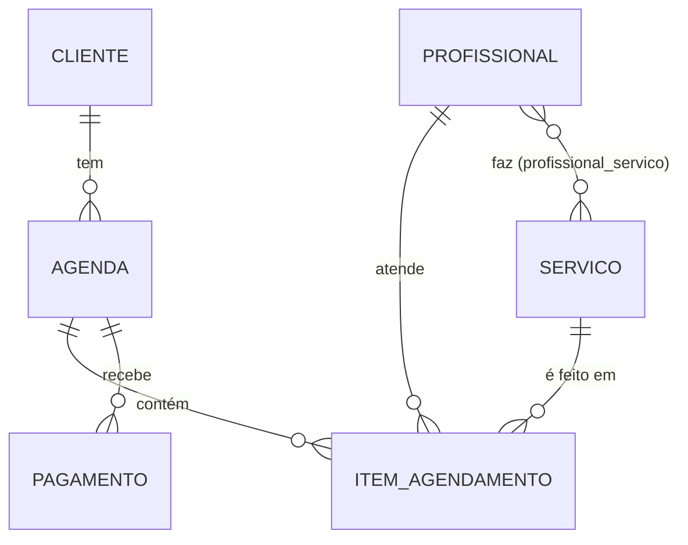

# Sistema de Gestão para Salão de Beleza

Sistema web (API REST em Spring Boot + telas em React) para agendamento, histórico de clientes e controle de pagamentos de um salão de beleza. Projeto de Extensão em Computação Avançada (SM262208, 2026/2) de **Leonardo Tricano Costa**, desenvolvido para o salão parceiro **Studio WL** (Cachambi, Rio de Janeiro).

| | |
|---|---|
| Protótipo navegável | https://leotricano.github.io/sistemasalao/prototipo/ (branch `gh-pages`) |
| Quadro de tarefas | https://github.com/users/leotricano/projects/1 |
| Professor | Ricardo Pires Mesquita |

**Situação em 16/11/2026 (pronto para piloto no salão):** telas em React servidas pela própria API, login com perfis (dono, recepção e profissional), cadastros, agendamento com vários serviços e profissionais, bloqueio de conflito de horário, cancelar e remarcar, agenda do dia e da semana, histórico do cliente, pagamento com troco e relatório de faturamento com planilha. Todo erro volta com status HTTP correto e mensagem em português. A API tem 46 testes automatizados e o desenvolvimento segue o GitHub Flow, com a `master` protegida. Próximos: ajustar o conflito de horário por profissional no backend (#28), especialidade com pacote de serviços (#29) e hospedagem na nuvem (#27).

---

## Stack

| Camada | Tecnologia |
|---|---|
| Linguagem | Java 21 |
| Framework | Spring Boot 4.1.1 (Web MVC, Data JPA, Validation, Security) |
| Banco de dados | PostgreSQL 15 |
| Build | Maven (wrapper `mvnw` incluído) |
| Frontend | React 18 + Vite 5 (pasta `frontend/`) |
| Login | Spring Security + token JWT |

Arquitetura monolítica em camadas: **Controller → Service → Repository → Entidades**, conforme a Tarefa 2.

---

## Como rodar

### 1. Pré-requisitos
- JDK 21 e `JAVA_HOME` apontando para ele (ex.: `C:\Program Files\Java\jdk-21`)
- PostgreSQL rodando em `localhost:5432`

### 2. Criar o banco (uma vez por computador)
O banco **não vai pelo Git**: cada máquina precisa do seu. As tabelas o Hibernate cria sozinho; o banco, não.

```sql
CREATE DATABASE sistemasalao;
```

### 3. Variáveis de ambiente
| Variável | Obrigatória | Padrão |
|---|---|---|
| `DB_PASSWORD` | sim | — |
| `DB_USERNAME` | não | `postgres` |
| `JWT_SECRET` | recomendada | sem ela, uma chave é sorteada a cada início e todos precisam entrar de novo depois de reiniciar |
| `ADMIN_LOGIN` | não | `admin` |
| `ADMIN_SENHA` | não | sem ela, a conta do dono é criada pela tela de login no primeiro acesso (#46) |

| `MAIL_HOST` | não | sem ela, o "esqueci minha senha" fica desligado (ex.: `smtp.gmail.com`) |
| `MAIL_USUARIO` | com `MAIL_HOST` | o e-mail do salão que envia o código |
| `MAIL_SENHA` | com `MAIL_HOST` | no Gmail, uma **senha de app** (myaccount.google.com/apppasswords), não a senha normal |
| `MAIL_PORTA` | não | `587` |

`JWT_SECRET` é uma frase longa e aleatória que assina os tokens de login; quem a conhece consegue criar tokens, então ela não vai para o Git. `ADMIN_LOGIN` e `ADMIN_SENHA` só são usadas quando o banco ainda não tem nenhum usuário.

> Se criar a variável com o IntelliJ aberto, feche e abra de novo: programas só leem variáveis de ambiente ao iniciar.

### 4. Subir a aplicação
Pelo IntelliJ (`SistemasalaoApplication`) ou pelo terminal:

```bash
./mvnw spring-boot:run
```

A API sobe em `http://localhost:8080`. O sinal de sucesso é a linha `Started SistemasalaoApplication` no console.

### 5. Atualizações manuais no banco
O projeto usa `spring.jpa.hibernate.ddl-auto=update`, que **cria** tabelas e colunas novas, mas **nunca apaga colunas nem muda o tipo** de uma coluna existente. Quando uma mudança no código exige isso, o SQL fica registrado aqui e precisa ser rodado **em cada computador** que já tinha o banco:

| Data | Motivo | SQL |
|---|---|---|
| 27/10/2026 | Campo `especialiadade` renomeado para `especialidade` | `ALTER TABLE profissional DROP COLUMN IF EXISTS especialiadade;` |
| 27/10/2026 | #11: duração do serviço passou de texto para minutos (rode **antes** de subir a aplicação) | `ALTER TABLE servico ALTER COLUMN duracao TYPE integer USING duracao::integer;`<br>`ALTER TABLE servico RENAME COLUMN duracao TO duracao_minutos;` |

> Isso deve ser substituído por migrações versionadas com Flyway (ver Próximos passos).

### 6. Rodar os testes
Os testes **não precisam do PostgreSQL**: usam o banco H2 em memória, configurado em `src/test/resources/application.properties`, que nasce vazio a cada execução.

```bash
./mvnw test
```

O sinal de sucesso é `BUILD SUCCESS` com `Tests run: 46, Failures: 0, Errors: 0`. O resultado de cada classe fica em `target/surefire-reports/`.

| Classe | Tipo | O que testa |
|---|---|---|
| `AgendaServiceTest` | Unidade (Mockito) | Conflito de horário, regras de status, remarcar, filtros da agenda |
| `RelatorioServiceTest` | Unidade (Mockito) | Cálculos do relatório: totais, ticket médio, por profissional e por forma de pagamento |
| `PagamentoServiceTest` | Unidade (Mockito) | Valor positivo e pagamento da agenda certa |
| `RotasPrincipaisTest` | Integração (MockMvc + H2) | As rotas de ponta a ponta: cadastros, agendamento, 409, pagamento, conclusão, relatório, histórico e erros 400/404/409 |
| `SegurancaTest` | Integração (MockMvc + H2) | Login real com token, 401 sem token ou com token adulterado, 403 por perfil, profissional vendo só a própria agenda, troca de senha |
| `RecuperacaoSenhaTest` | Integração (MockMvc + H2, e-mail simulado) | Código por e-mail, código errado, 5 tentativas, código usado não serve de novo, resposta igual para quem não existe, e-mail da própria conta |
| `AcessoSemEmailTest` | Integração (MockMvc + H2, banco sem usuários) | Primeiro acesso só do próprio computador e só sem usuários, administrador redefinindo senha (e recepção recebendo 403), chave reserva do computador |
| `SistemasalaoApplicationTests` | Integração | A aplicação sobe |

Nos testes de unidade, os repositórios são *mocks* (objetos falsos do Mockito) e só a regra do service é testada. Nos de integração, a aplicação sobe inteira e as requisições passam por controller, service, repositório e banco. As entidades têm construtor `protected`, então os testes criam objetos pela classe `Fabrica`, que fica no mesmo pacote `model` dentro de `src/test`.

---

### 7. Telas (frontend)
As telas ficam em `frontend/` e conversam com a API. Para trabalhar nelas, com a API rodando:

```bash
cd frontend
npm install
npm run dev
```

Abra `http://localhost:5173`. O Vite repassa as chamadas da API para `http://localhost:8080` (ver `frontend/vite.config.js`) e recarrega a tela a cada arquivo salvo.

`npm run build` gera as telas prontas em `src/main/resources/static/` (fora do Git). A partir daí a própria API serve o sistema inteiro em `http://localhost:8080`, sem precisar do Node.

---

## Colocar em uso no salão

O sistema roda num computador do salão, e os outros aparelhos (celular, tablet, outro computador) acessam pela rede Wi-Fi.

**No computador do salão, uma vez:**
1. Instale o **Java 21** e o **PostgreSQL 15** e crie o banco `sistemasalao` (ver "Como rodar").
2. Crie as variáveis de ambiente do Windows (Painel de Controle → "Editar as variáveis de ambiente para sua conta"): `JAVA_HOME` (pasta do Java 21, ex.: `C:\Program Files\Java\jdk-21`), `DB_PASSWORD`, `JWT_SECRET` (uma frase longa e aleatória) e, se quiser escolher a senha inicial, `ADMIN_SENHA`. Feche e abra de novo as janelas do terminal depois de criar.
3. Para gerar o sistema, instale também o **Node.js 20+** e rode `gerar-sistema.cmd`. Ele monta as telas, roda os testes e cria `target/sistemasalao-0.0.1-SNAPSHOT.jar`.
4. Libere a porta 8080 no Firewall do Windows para a rede privada, se os outros aparelhos não conseguirem abrir. Com uma VPN ligada (ex.: NordVPN), os aparelhos da rede local podem não enxergar o computador; nesse caso, permita o acesso à rede local nas configurações da VPN.

**Todo dia:** rode `iniciar-sistema.cmd` e deixe a janela aberta. Acesse `http://localhost:8080` no próprio computador, ou `http://IP-DO-COMPUTADOR:8080` nos outros aparelhos (o IP aparece em `ipconfig`, "Endereço IPv4").

**Primeiro acesso (#46):** com o banco vazio, abra `http://localhost:8080` **no próprio computador do salão**. A tela mostra "Criar a conta do dono": informe nome, login e senha e o sistema já entra. De outro aparelho essa tela é recusada, para ninguém da rede se adiantar. Depois crie em "Acessos" o login da recepção e de cada profissional. (Se `ADMIN_SENHA` estiver definida, o sistema cria o `admin` com ela em vez de mostrar a tela.)

**Se alguém esquecer a senha (sem e-mail, #46):**

| Quem esqueceu | O que fazer |
|---|---|
| Recepção ou profissional | O dono abre "Acessos", clica em **Redefinir senha** na pessoa e passa a senha nova. A pessoa troca depois em "Minha conta". |
| Um dos donos | O outro administrador faz o mesmo em "Acessos". Por isso vale ter **dois administradores** (ex.: o dono e quem cuida do sistema). |
| Todos os administradores | No computador do salão, rode `redefinir-senha-dono.cmd` (ou `redefinir-senha-dono.cmd login`). Ele pergunta o login e a senha nova, sem mostrar o que é digitado, e grava direto no banco. Se o login não existir, cria um administrador com ele. Só funciona nesse computador, porque precisa do banco e da `DB_PASSWORD`. |

| Perfil | O que vê no menu |
|---|---|
| Administrador (dono) | Agenda, Novo agendamento, Clientes, Serviços, Profissionais, Relatório, Acessos |
| Recepção | Agenda, Novo agendamento, Clientes, Serviços e Profissionais (só consulta) |
| Profissional | Só a própria agenda |

**No celular como aplicativo (#43):** abra o sistema no navegador do celular, entre com "Manter conectado" marcado e use "Adicionar à tela inicial" (Android) ou "Adicionar à Tela de Início" (iPhone). O ícone da tesoura aparece junto dos outros aplicativos. O passo a passo também está em "Minha conta".

**Backup:** os dados ficam só no PostgreSQL desse computador. Faça cópia do banco com frequência, por exemplo com `pg_dump -U postgres sistemasalao > backup.sql` num pendrive ou na nuvem.

---

## Estrutura do código

```
src/main/java/br/com/leotricano/sistemasalao/
├── config/        SecurityConfig: libera todos os endpoints durante o desenvolvimento
├── controller/    Recebe as requisições HTTP e devolve DTOs
├── dto/           Records de resposta (o "contrato" do JSON)
├── exception/     Exceções de regra de negócio e o TratadorDeErros, que as transforma em respostas HTTP
├── model/         Entidades JPA (tabelas) e enums
├── repository/    Interfaces Spring Data JPA (acesso ao banco)
└── service/       Regras de negócio
```

### Comentários no código

Todas as classes têm comentários em português para quem está lendo o código pela primeira vez:

- **Acima de cada classe:** o que ela representa e onde se encaixa nas camadas.
- **Acima de cada método:** o que faz, as regras aplicadas e o que devolve quando algo dá errado.
- **Nas linhas não óbvias:** o que cada anotação faz (`@ManyToOne`, `mappedBy`, `cascade`, `@Valid`...) e o porquê das decisões.
- **`TODO(#n)`:** pontos que ainda vão mudar, com o número do card no quadro. Para ver todos no IntelliJ: **View → Tool Windows → TODO**.

### Modelo de dados



| Entidade | Campos principais |
|---|---|
| `Cliente` | nome, email, telefone |
| `Servico` | nome, duracaoMinutos (inteiro, maior que zero), preco |
| `Profissional` | nome, especialidade, servicos (N:N) |
| `Agenda` | cliente, dataHora, status (`AGENDADO`, `CONCLUIDO`, `CANCELADO`), itens |
| `ItemAgendamento` | agenda, servico, profissional, precoCobrado |
| `Pagamento` | agenda, valor, formaPagamento (`DINHEIRO`, `CARTAO`, `PIX`), dataHora |

---

## Endpoints

Todas as rotas, menos as marcadas como "aberta", exigem o cabeçalho `Authorization: Bearer <token>` (ver [Login e perfis](#login-e-perfis-18)). Sem token, a resposta é `401`; com um perfil sem permissão, `403`.

| Método | Rota | O que faz |
|---|---|---|
| POST | `/auth/login` | Entra com `{"login":"...","senha":"..."}` e recebe o token |
| GET | `/auth/me` | Dados de quem está logado |
| PUT | `/auth/senha` | Troca a própria senha (`{"senhaAtual":"...","novaSenha":"..."}`) |
| PUT | `/auth/me` | Cadastra ou troca o próprio e-mail (`{"email":"..."}`) |
| GET | `/auth/opcoes` | Se o "esqueci minha senha" está ligado e se é o primeiro acesso (aberta) |
| POST | `/auth/primeiro-acesso` | Cria a conta do dono quando não há usuários (`{"nome","login","senha"}`, aberta, só do próprio computador) |
| POST | `/auth/esqueci-senha` | Manda o código por e-mail (`{"loginOuEmail":"..."}`, aberta) |
| POST | `/auth/redefinir-senha` | Cria a senha nova com o código (`{"loginOuEmail","codigo","novaSenha"}`, aberta) |
| GET | `/usuarios` | Lista os acessos (ADMIN) |
| POST | `/usuarios` | Cria um acesso (ADMIN) |
| PUT | `/usuarios/{id}/senha` | Cria uma senha nova para alguém (`{"novaSenha":"..."}`, ADMIN) |
| DELETE | `/usuarios/{id}` | Remove um acesso (ADMIN) |
| GET | `/clientes` | Lista clientes |
| POST | `/clientes` | Cadastra cliente |
| PUT | `/clientes/{id}` | Atualiza cliente |
| DELETE | `/clientes/{id}` | Remove cliente |
| GET | `/clientes/{id}/historico?status=` | Histórico do cliente: resumo + agendas da mais recente para a mais antiga (ver [Histórico do cliente](#histórico-do-cliente-16)) |
| GET | `/servicos` | Lista serviços |
| POST | `/servicos` | Cadastra serviço |
| PUT | `/servicos/{id}` | Atualiza serviço |
| DELETE | `/servicos/{id}` | Remove serviço |
| GET | `/profissionais` | Lista profissionais com seus serviços |
| POST | `/profissionais` | Cadastra profissional |
| PUT | `/profissionais/{id}` | Atualiza profissional |
| DELETE | `/profissionais/{id}` | Remove profissional |
| POST | `/profissionais/{id}/servicos/{servicoId}` | Vincula um serviço ao profissional |
| DELETE | `/profissionais/{id}/servicos/{servicoId}` | Desvincula um serviço |
| GET | `/agendas?de=&ate=&profissionalId=&status=` | Lista agendamentos em ordem de horário; todos os filtros são opcionais (ver [Consulta da agenda](#consulta-da-agenda-15)) |
| GET | `/agendas/{id}` | Detalhe do agendamento, com itens, término, duração e total |
| POST | `/agendas` | Cria agendamento, sempre como AGENDADO (`{"cliente":{"id":1},"dataHora":"2026-11-03T14:00:00"}`) |
| PUT | `/agendas/{id}/status` | Conclui, cancela ou reativa (corpo: `"CONCLUIDO"`, `"CANCELADO"` ou `"AGENDADO"`) |
| PUT | `/agendas/{id}/remarcar` | Remarca para outra data e hora (`{"dataHora":"2026-11-05T10:00:00"}`) |
| DELETE | `/agendas/{id}` | Remove agendamento |
| POST | `/agendas/{id}/itens?servicoId=&profissionalId=` | Adiciona um serviço ao agendamento (409 se houver conflito de horário) |
| DELETE | `/agendas/{id}/itens/{itemId}` | Remove um serviço do agendamento |
| GET | `/agendas/{id}/pagamentos` | Lista pagamentos do agendamento |
| POST | `/agendas/{id}/pagamentos?valor=&formaPagamento=` | Registra pagamento |
| DELETE | `/agendas/{id}/pagamentos/{pagamentoId}` | Remove pagamento |
| GET | `/relatorios/faturamento?de=&ate=&profissionalId=` | Relatório de faturamento do período (ver [Relatório de faturamento](#relatório-de-faturamento-17)) |

### Login e perfis (#18)

O login devolve um **token JWT** válido por 12 horas, ou por **30 dias** com "Manter conectado" marcado (#43), para o celular de cada profissional não pedir senha todo dia. O frontend guarda o token e o manda em toda requisição. A API não guarda sessão: a assinatura do token prova quem é a pessoa e qual o perfil dela. As senhas são gravadas só como hash **BCrypt**.

| Perfil | Quem é | Pode |
|---|---|---|
| `ADMIN` | Dono do salão | Tudo, incluindo relatório de faturamento, cadastro de serviços e profissionais e os acessos |
| `RECEPCAO` | Recepção | Agenda, clientes, pagamentos; **não** vê o faturamento nem altera serviços, profissionais e acessos |
| `PROFISSIONAL` | Cabeleireiro, manicure... | Só consulta **a própria agenda**: o filtro `profissionalId` é forçado para o dele, e agenda de outro dá 404 |

**Esqueci minha senha (#42):** com o e-mail do salão configurado (`MAIL_HOST`, `MAIL_USUARIO`, `MAIL_SENHA`), a tela de login mostra "Esqueci minha senha". A pessoa informa o login ou o e-mail, recebe um código de 6 dígitos e cria uma senha nova. O código vale 15 minutos e aceita 5 tentativas, e é guardado só como hash. A resposta é a mesma exista ou não o usuário, para ninguém descobrir quem tem cadastro. O e-mail de cada pessoa é cadastrado pelo dono em "Acessos" ou pela própria pessoa em "Minha conta".

**Primeiro acesso (#46):** se o banco não tem nenhum usuário, `GET /auth/opcoes` responde `"primeiroAcesso": true` e a tela de login mostra "Criar a conta do dono". `POST /auth/primeiro-acesso` cria o ADMIN e já devolve o token, mas só aceita pedidos vindos do próprio computador (endereço de loopback, `127.0.0.1`); de outro aparelho, `403`. Com `ADMIN_SENHA` definida, o sistema cria o administrador `ADMIN_LOGIN` ao subir e a tela não aparece.

**Sem e-mail (#46):** o administrador cria uma senha nova para qualquer pessoa com `PUT /usuarios/{id}/senha`, sem precisar da antiga. Se nenhum administrador lembrar a senha, `redefinir-senha-dono.cmd` sobe a aplicação em modo de terminal (`--redefinir-senha`, sem abrir o site), pergunta login e senha nova e grava no banco (classe `RedefinirSenhaPeloComputador`).

### Respostas de erro

Todo erro da API volta no mesmo formato, para o frontend só precisar mostrar a `mensagem`:

```json
{"status": 404, "mensagem": "Agenda 99 não encontrada."}
```

| HTTP | Quando | Exemplo de mensagem |
|---|---|---|
| 400 | Regra do salão violada | `William não faz o serviço Manicure.` |
| 400 | Campo inválido (`@Valid`) | `duracaoMinutos: deve ser maior que 0; nome: não deve estar em branco` |
| 400 | JSON malformado, tipo errado ou enum inválido | `Corpo da requisição inválido: confira o formato do JSON e o tipo de cada campo.` |
| 400 | Parâmetro de URL inválido ou ausente | `Valor inválido para o parâmetro 'formaPagamento': BOLETO.` |
| 404 | Id que não existe | `Cliente 99 não encontrado.` |
| 409 | Conflito de horário | `William já tem atendimento em 03/11/2026 das 14:00 às 17:00 (agenda 1, cliente Ana Paula).` |
| 409 | Apagar algo em uso | `Não é possível concluir: o registro está ligado a outros dados...` |
| 500 | Erro inesperado | `Erro inesperado no servidor.` (o detalhe fica só no log) |

Quem faz isso é o `exception/TratadorDeErros`: os services lançam exceções e ele escolhe o status e a mensagem.

### Ciclo de vida do agendamento (#14)

Toda agenda nasce **AGENDADO**, mesmo que o JSON mande outro status.

```
              concluir (precisa ter serviço)
  AGENDADO  ─────────────────────────────►  CONCLUIDO   (final: não muda mais)
     │  ▲
     │  │ reativar (só se o horário continuar livre → senão 409)
     ▼  │
  CANCELADO   (não pode ser concluído direto)
```

| Ação | Regra | Erro |
|---|---|---|
| Cancelar | não pode ter pagamento registrado | 400 |
| Concluir | precisa ter pelo menos um serviço; pagamento pode vir depois | 400 |
| Reativar (CANCELADO → AGENDADO) | o horário precisa estar livre para os profissionais | 409 |
| Mudar um atendimento CONCLUIDO | nunca | 400 |
| Remarcar | só AGENDADO, data no futuro, horário livre | 400 / 409 |
| Incluir ou remover serviço | só em agenda AGENDADA | 400 |

### Consulta da agenda (#15)

`GET /agendas` aceita filtros opcionais, que podem ser combinados. O resultado vem sempre **ordenado por horário**, como na grade da agenda.

| Chamada | Devolve |
|---|---|
| `GET /agendas` | tudo (sem filtro) |
| `GET /agendas?de=2026-11-03&ate=2026-11-03` | o dia 03/11 |
| `GET /agendas?de=2026-11-02&ate=2026-11-08` | a semana de 02 a 08/11 |
| `GET /agendas?de=2026-11-02&ate=2026-11-08&profissionalId=2` | só as agendas em que algum serviço é com o profissional 2 |
| `GET /agendas?de=2026-11-02&ate=2026-11-08&status=AGENDADO` | só um status (ex.: esconder os cancelados) |

| Regra | Erro |
|---|---|
| `de` e `ate` são dias inteiros e os dois entram (`de=03/11&ate=03/11` = 03/11 das 00:00 às 23:59) | — |
| Informar só uma das datas | 400 |
| `de` depois de `ate` | 400 |
| Período maior que 62 dias | 400 |
| Data fora do formato `aaaa-mm-dd` ou status inexistente | 400 |
| Profissional que não existe | 404 (e não lista vazia, que pareceria "dia livre") |

A API recebe um **período**, e não "dia" ou "semana": quem decide se a semana começa no domingo ou na segunda é o frontend. Assim o mesmo endpoint serve para dia, semana e, depois, o mês do relatório.

### Histórico do cliente (#16)

`GET /clientes/1/historico` devolve um resumo e as agendas do cliente, da **mais recente para a mais antiga**:

```json
{
  "clienteId": 1,
  "nomeCliente": "Ana Paula",
  "totalAtendimentos": 2,
  "ultimoAtendimento": "2026-10-01T10:00:00",
  "totalGasto": 300.00,
  "agendas": [ { "id": 18, "status": "AGENDADO", ... }, { "id": 16, "status": "CONCLUIDO", ... } ]
}
```

| Regra | Detalhe |
|---|---|
| O resumo conta só agendas **CONCLUÍDAS** | Canceladas e futuras aparecem na lista, com o status, mas não entram em `totalAtendimentos`, `ultimoAtendimento` e `totalGasto` |
| `totalGasto` soma o valor dos serviços (`precoCobrado`) | Não usa os pagamentos, que hoje podem passar do total |
| `?status=CONCLUIDO` filtra só a lista | O resumo continua o mesmo, para o filtro não "zerar" o cliente |
| Cliente sem agendas | 200, com lista vazia, `0` e `ultimoAtendimento: null` |
| Cliente que não existe | 404 |
| Status inválido | 400 |

A busca usa uma **consulta derivada** do Spring Data: `findByClienteIdOrderByDataHoraDescIdDesc`. O SQL é montado a partir do nome do método, sem `@Query`.

### Relatório de faturamento (#17)

`GET /relatorios/faturamento?de=2026-11-01&ate=2026-11-30` devolve o fechamento do período:

```json
{
  "de": "2026-11-01", "ate": "2026-11-30", "profissionalId": null,
  "atendimentos": 3, "clientesAtendidos": 2,
  "faturamento": 340.00, "ticketMedio": 113.33, "totalRecebido": 300.00,
  "porProfissional": [ { "profissionalId": 1, "nome": "William", "atendimentos": 2, "faturamento": 280.00 }, ... ],
  "porFormaPagamento": [ { "formaPagamento": "DINHEIRO", "total": 0 }, { "formaPagamento": "CARTAO", "total": 100.00 }, { "formaPagamento": "PIX", "total": 200.00 } ]
}
```

| Regra | Detalhe |
|---|---|
| Só agendas **CONCLUÍDAS** que começaram no período | Agendadas ainda não são faturamento; canceladas não aconteceram |
| `faturamento` soma o `precoCobrado` dos serviços | É o valor do dia do atendimento, igual ao total do agendamento |
| `totalRecebido` soma os pagamentos dessas agendas | Pode ser menor que o faturamento: concluir sem pagamento é permitido |
| `ticketMedio` = faturamento ÷ atendimentos | 2 casas; `0.00` se não houve atendimento |
| `&profissionalId=` | Conta só os serviços desse profissional; o recebido mostra os pagamentos das agendas em que ele atendeu (pagamento não é dividido por profissional) |
| `porFormaPagamento` | Traz sempre as três formas, mesmo zeradas, pronto para a tabela e para o Excel (#30) |
| Datas obrigatórias, `de` ≤ `ate`, até 366 dias | 400 |
| Profissional que não existe | 404 |
| Período sem atendimentos | 200, com tudo zerado |

### Regras de negócio já implementadas
- Um item só é aceito se o profissional **faz** aquele serviço (vínculo em `profissional_servico`).
- O preço do serviço é **copiado** para `precoCobrado` no momento do agendamento, para que um reajuste futuro não altere atendimentos antigos.
- Um agendamento pode ter vários itens, cada um com seu próprio profissional.
- O total do agendamento é a soma de `precoCobrado` dos itens, e a duração total é a soma de `duracaoMinutos` dos serviços (ambos calculados no `AgendaResponse`).
- **Conflito de horário (#12):** uma agenda ocupa todos os profissionais dela de `dataHora` até `dataHoraFim` (início + soma das durações). Incluir um serviço que faça algum desses profissionais ter outro atendimento sobreposto, não cancelado, é recusado com `409 Conflict` e uma mensagem como `"William já tem atendimento em 03/11/2026 das 14:00 às 17:00 (agenda 1, cliente Ana Paula)"`. Encostar (um termina às 14:00, outro começa às 14:00) é permitido.
- Um pagamento precisa ter valor maior que zero, e só pode ser apagado pela agenda a que pertence.
- A soma dos pagamentos de um agendamento **não passa do total** dele, e agendamento cancelado não recebe pagamento (#37). A mensagem diz quanto falta pagar.
- Não é possível apagar cliente, serviço, profissional ou agenda que estejam sendo usados por outros registros (409).
- A duração do serviço é obrigatória e precisa ser um número inteiro positivo de minutos; texto, zero ou negativo voltam `400 Bad Request`.

---

## O que já foi feito

| Card | Entrega | Requisito |
|---|---|---|
| #1 | CRUD de clientes | RF01 |
| #2 | CRUD de serviços | RF02 |
| #3 | CRUD de profissionais e vínculo com serviços | — |
| #4 | Agendamento com itens (serviço + profissional) | RF03 |
| #5 | Registro de pagamentos (Pix, cartão, dinheiro) | RF05 |
| #6 | Spring Security liberado durante o desenvolvimento | — |
| #7 | Protótipo navegável das telas (Tarefa 3) | — |
| #8 | Conexão com o PostgreSQL | — |
| #9 | Validação do protótipo com o dono do salão | — |
| #10 | DTOs de resposta: fim do loop infinito no JSON | — |
| #11 | Duração do serviço em minutos (`duracaoMinutos`) e duração total do agendamento | RF02 |
| #12 | Bloqueio de conflito de horário por profissional, com resposta 409 | RF03 |
| #13 | Tratamento de erros: exceções nos services, `TratadorDeErros` e formato único de erro | — |
| #14 | Cancelar, reativar e remarcar, com regras de mudança de status | RF08 |
| #15 | Consulta da agenda por período (dia, semana), profissional e status, em ordem de horário | RF04 |
| #16 | Histórico de atendimentos do cliente, com resumo (atendimentos, último atendimento, total gasto) | RF06 |
| #31 | Estratégia de branches (GitHub Flow) e proteção da `master` com ruleset | — |
| #17 | Relatório de faturamento por período e profissional | RF07 |
| #26 | Testes automatizados: unidade (JUnit + Mockito) e integração das rotas (MockMvc + H2) | — |
| #18 | Login com token JWT e perfis ADMIN, RECEPCAO e PROFISSIONAL; profissional vê só a própria agenda | RNF01 |
| #37 | Pagamento não passa do total do atendimento | RF05 |
| #19 | Telas em React: login, menu por perfil, agenda do dia e da semana, novo agendamento no fluxo pedido pelo dono, detalhe do atendimento | RF03, RF04 |
| #20 | Telas de clientes (com ficha e histórico), serviços e profissionais | RF01, RF02, RF06 |
| #21 | Pagamento com troco e relatório de faturamento do mês com planilha para o Excel | RF05, RF07 |
| #42 | Esqueci minha senha: código de 6 dígitos por e-mail | RNF01 |
| #43 | Manter conectado por 30 dias e atalho na tela inicial do celular | — |
| #46 | Recuperar o acesso sem e-mail: redefinir senha em Acessos, primeiro acesso pela tela, `redefinir-senha-dono.cmd` | RNF01 |

## O que vamos fazer

### Sprint 1 (27/10 a 02/11) ✅
- [x] **#11** Duração do serviço em minutos (RF02)
- [x] **#12** Bloquear conflito de horário do profissional (RF03)
- [x] **#13** Tratamento de erros com `@RestControllerAdvice`

### Sprint 2 (03/11 a 09/11)
- [x] **#14** Cancelar e remarcar agendamento (RF08)
- [x] **#15** Consultar agenda por dia, semana e profissional (RF04)
- [x] **#16** Histórico de atendimentos do cliente (RF06)
- [ ] **#28** Vários serviços por agendamento, começando pelo profissional (RF03 alterado)
- [ ] **#29** Especialidade com pacote de serviços padrão (RF09)

### Sprint 3 (10/11 a 16/11)
- [x] **#17** Relatório de faturamento por período e profissional (RF07)
- [x] **#18** Autenticação e perfis: administrador e profissional (RNF01)
- [ ] **#30** Exportar relatório para Excel (RF10)

### Sprint 4 (17/11 a 30/11)
- [x] **#19** Frontend: configuração do React, login e agenda
- [x] **#20** Frontend: clientes e serviços
- [x] **#21** Frontend: pagamento e relatório

### Backlog
Comissões (#22), agendamento online pelo cliente (#23), lembretes por WhatsApp (#24), IA para prever faltas (#25), Docker e deploy (#27).

---

## Estratégia de branches

O projeto segue o **GitHub Flow**: a `master` guarda sempre a versão estável, e toda mudança é feita num branch próprio, ligado a um card do [quadro de tarefas](https://github.com/users/leotricano/projects/1), que só entra na `master` por Pull Request.

**Por que GitHub Flow e não Git Flow:** o Git Flow usa vários branches fixos (`develop`, `release`, `hotfix`) e foi pensado para equipes grandes com versões programadas. Este é um projeto individual com entregas contínuas por sprint, então um único branch estável mais branches curtos por tarefa dão o mesmo controle com muito menos trabalho.

### Nomes dos branches

`tipo/numero-do-card-descricao-curta`

| Tipo | Uso | Exemplo |
|---|---|---|
| `feature/` | funcionalidade nova | `feature/17-relatorio-faturamento` |
| `fix/` | correção de bug | `fix/40-pagamento-acima-do-total` |
| `test/` | testes automatizados | `test/26-testes-agenda` |
| `docs/` | documentação | `docs/31-estrategia-branches` |

O número liga o branch ao card, e quem lê o nome já sabe qual tarefa ele resolve.

### Fluxo de trabalho

1. Atualizar a `master`: `git switch master` e `git pull`.
2. Criar o branch do card: `git switch -c feature/17-relatorio-faturamento`.
3. Fazer commits pequenos, um por passo lógico, com mensagem descritiva.
4. Enviar o branch: `git push -u origin feature/17-relatorio-faturamento`.
5. Abrir o Pull Request para a `master` com `Closes #17` na descrição, o que fecha o card no merge.
6. Conferir o diff do PR e fazer o merge.
7. O GitHub apaga o branch remoto sozinho; o local sai com `git switch master`, `git pull` e `git branch -d feature/17-relatorio-faturamento`.

### Proteção da `master`

O ruleset `proteger-master` do GitHub garante que o fluxo seja seguido:

| Regra | O que impede |
|---|---|
| Exigir Pull Request antes do merge | push direto na `master`: toda mudança passa por PR e fica registrada |
| Bloquear force push | reescrever ou apagar o histórico da `master` |
| Restringir exclusão | apagar a `master` por engano |

O PR exige **0 aprovações** porque o projeto tem um único desenvolvedor; o PR serve como ponto de conferência e registro. O repositório também apaga automaticamente o branch depois do merge, para que a lista de branches mostre só o que está em andamento.

> Até 16/11/2026 (cards #1 a #16) os commits eram feitos direto na `master`. A estratégia vale a partir do card #31.

---

## Decisões técnicas

| Decisão | Motivo |
|---|---|
| **DTOs (records) nas respostas** | Entidades se referenciam nos dois sentidos (agenda ↔ itens, profissional ↔ serviços) e causavam recursão infinita no JSON. O DTO também entrega o dado pronto para a tela (ex.: `nomeCliente`, `total`) e permite mudar a entidade sem quebrar o frontend. |
| **`BigDecimal` para dinheiro** | `double` tem erro de arredondamento em valores monetários. |
| **`precoCobrado` no item** | Guarda o preço do dia do atendimento, independente de reajustes. |
| **Login com JWT em vez de sessão** | O frontend é separado da API; o token vai no cabeçalho e a API não precisa guardar quem está logado. A chave fica em `JWT_SECRET`, fora do código. |
| **Perfil RECEPCAO além de ADMIN e PROFISSIONAL** | A Tarefa 2 tem a persona Recepção: quem atende o balcão precisa agendar e receber, mas não precisa ver o faturamento do salão. |
| **Conflito: a agenda inteira é um bloco** | Hoje a agenda tem um único horário de início. Os serviços acontecem em sequência, então todos os profissionais dela ficam ocupados do início ao fim. É conservador (uma manicure que só faz a última parte também fica bloqueada desde o início) e será refinado no #28. |
| **Exceções + `@RestControllerAdvice`** | Os services lançam `RecursoNaoEncontradoException` (404), `RegraNegocioException` (400) ou `ConflitoHorarioException` (409) em vez de devolver `null`. O `TratadorDeErros` transforma cada uma na resposta certa, e os controllers ficam sem `if` nem try/catch. |
| **Concluir sem pagamento é permitido** | O cliente pode pagar depois. Se o salão quiser exigir pagamento antes de concluir, é uma verificação a mais em `AgendaService.atualizarStatus`. |
| **Cancelar com pagamento é bloqueado** | Evita agenda cancelada contando no faturamento. Para cancelar, o pagamento precisa ser removido antes (estorno ainda não existe). |
| **Cancelar em vez de apagar** | `DELETE /agendas/{id}` é para corrigir lançamento errado. Para desmarcar, o certo é cancelar, que mantém o histórico do cliente. |
| **Filtros opcionais numa só consulta JPQL** | Cada filtro é `(:x is null or ...)`: quando o parâmetro não vem, a condição é ignorada. O `cast(:x as Tipo)` é necessário porque o PostgreSQL não descobre sozinho o tipo de um parâmetro em `? is null`. |
| **Resumo do histórico no service** | O que conta como atendimento e como somar o gasto é regra de negócio, então o `ClienteService.historico` já devolve o `HistoricoClienteResponse` montado. As agendas são buscadas uma vez e filtradas em Java, porque o resumo precisa de todas, mesmo quando a lista vem filtrada. |
| **Erro 500 sem detalhes** | O stack trace vai só para o log da aplicação; mandá-lo para quem chamou a API exporia o funcionamento interno. |
| **Telas servidas pela própria API** | O `npm run build` coloca o React dentro do `.jar`. No salão roda um programa só, sem servidor web separado. |
| **HashRouter nas telas** | As rotas das telas ficam depois do `#` (`/#/clientes`), então nunca se confundem com as rotas da API (`/clientes`). |
| **Novo agendamento no front, em partes** | A tela cria a agenda e inclui um serviço por vez. Se um serviço for recusado (ex.: 409), apaga a agenda recém-criada para não sobrar agendamento pela metade. |
| **Monolito em camadas** | Projeto de pequeno porte e desenvolvedor único; microsserviços trariam complexidade sem benefício (Tarefa 2). |

## Problemas conhecidos

| Problema | Onde resolver |
|---|---|
| Numa agenda com vários profissionais, todos ficam bloqueados pelo tempo total, mesmo quem só atende uma parte | #28 |
| A maioria das entradas (`@RequestBody`) ainda recebe entidades; só o remarcar já usa DTO de entrada (`RemarcarRequest`) | DTOs de entrada, sem card ainda |
| Mudanças de esquema do banco são feitas com SQL manual | Flyway, sem card ainda |
