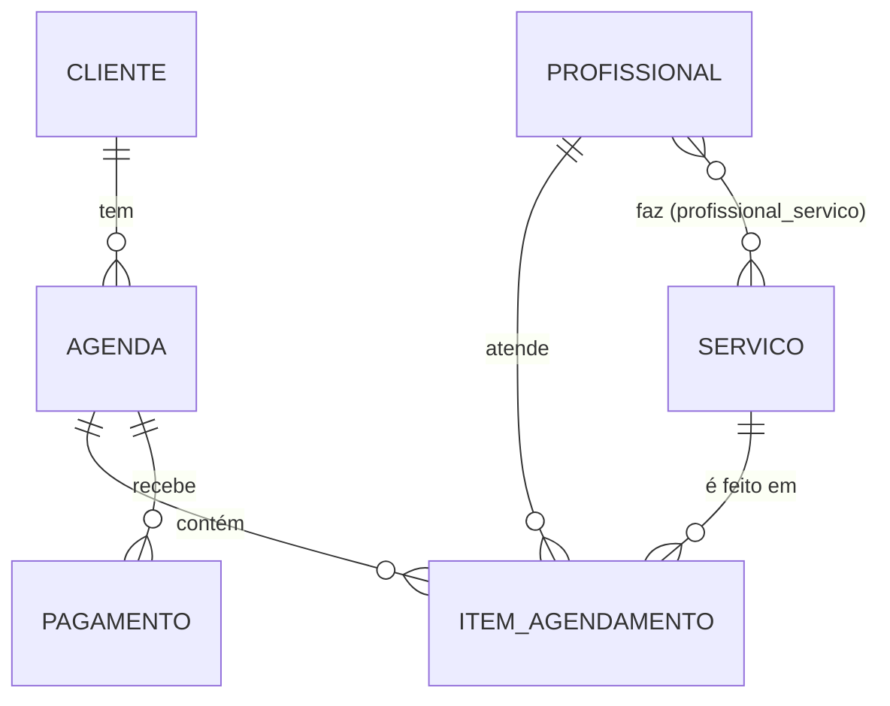

# Sistema de Gestão para Salão de Beleza

API REST em Spring Boot para agendamento, histórico de clientes e controle de pagamentos de um salão de beleza. Projeto de Extensão em Computação Avançada (SM262208, 2026/2) de **Leonardo Tricano Costa**, desenvolvido para o salão parceiro **Studio WL** (Cachambi, Rio de Janeiro).

| | |
|---|---|
| Protótipo navegável | https://leotricano.github.io/sistemasalao/prototipo/ (branch `gh-pages`) |
| Quadro de tarefas | https://github.com/users/leotricano/projects/1 |
| Professor | Ricardo Pires Mesquita |

**Situação em 27/10/2026:** Sprint 1 em andamento. Cadastros, agendamento com vários itens e pagamentos funcionam. Os JSONs de resposta usam DTOs, a duração dos serviços é guardada em minutos e a API recusa horários sobrepostos para o mesmo profissional. Falta o tratamento geral de erros e o relatório.

---

## Stack

| Camada | Tecnologia |
|---|---|
| Linguagem | Java 21 |
| Framework | Spring Boot 4.1.1 (Web MVC, Data JPA, Validation, Security) |
| Banco de dados | PostgreSQL 15 |
| Build | Maven (wrapper `mvnw` incluído) |
| Frontend (planejado) | React |

Arquitetura monolítica em camadas: **Controller → Service → Repository → Entidades**, conforme a Tarefa 2.

---

## Como rodar

### 1. Pré-requisitos
- JDK 21 e `JAVA_HOME` apontando para ele (ex.: `C:\Program Files\Java\jdk-21`)
- PostgreSQL rodando em `localhost:5432`

### 2. Criar o banco (uma vez por computador)
O banco **não vai pelo Git**: cada máquina precisa do seu. As tabelas o Hibernate cria sozinho; o banco, não.

```sql
CREATE DATABASE sistemasalao;
```

### 3. Variáveis de ambiente
| Variável | Obrigatória | Padrão |
|---|---|---|
| `DB_PASSWORD` | sim | — |
| `DB_USERNAME` | não | `postgres` |

> Se criar a variável com o IntelliJ aberto, feche e abra de novo: programas só leem variáveis de ambiente ao iniciar.

### 4. Subir a aplicação
Pelo IntelliJ (`SistemasalaoApplication`) ou pelo terminal:

```bash
./mvnw spring-boot:run
```

A API sobe em `http://localhost:8080`. O sinal de sucesso é a linha `Started SistemasalaoApplication` no console.

### 5. Atualizações manuais no banco
O projeto usa `spring.jpa.hibernate.ddl-auto=update`, que **cria** tabelas e colunas novas, mas **nunca apaga colunas nem muda o tipo** de uma coluna existente. Quando uma mudança no código exige isso, o SQL fica registrado aqui e precisa ser rodado **em cada computador** que já tinha o banco:

| Data | Motivo | SQL |
|---|---|---|
| 27/10/2026 | Campo `especialiadade` renomeado para `especialidade` | `ALTER TABLE profissional DROP COLUMN IF EXISTS especialiadade;` |
| 27/10/2026 | #11: duração do serviço passou de texto para minutos (rode **antes** de subir a aplicação) | `ALTER TABLE servico ALTER COLUMN duracao TYPE integer USING duracao::integer;`<br>`ALTER TABLE servico RENAME COLUMN duracao TO duracao_minutos;` |

> Isso deve ser substituído por migrações versionadas com Flyway (ver Próximos passos).

---

## Estrutura do código

```
src/main/java/br/com/leotricano/sistemasalao/
├── config/        SecurityConfig: libera todos os endpoints durante o desenvolvimento
├── controller/    Recebe as requisições HTTP e devolve DTOs
├── dto/           Records de resposta (o "contrato" do JSON)
├── exception/     Exceções de regra de negócio e o TratadorDeErros, que as transforma em respostas HTTP
├── model/         Entidades JPA (tabelas) e enums
├── repository/    Interfaces Spring Data JPA (acesso ao banco)
└── service/       Regras de negócio
```

### Comentários no código

Todas as classes têm comentários em português para quem está lendo o código pela primeira vez:

- **Acima de cada classe:** o que ela representa e onde se encaixa nas camadas.
- **Acima de cada método:** o que faz, as regras aplicadas e o que devolve quando algo dá errado.
- **Nas linhas não óbvias:** o que cada anotação faz (`@ManyToOne`, `mappedBy`, `cascade`, `@Valid`...) e o porquê das decisões.
- **`TODO(#n)`:** pontos que ainda vão mudar, com o número do card no quadro. Para ver todos no IntelliJ: **View → Tool Windows → TODO**.

### Modelo de dados



| Entidade | Campos principais |
|---|---|
| `Cliente` | nome, email, telefone |
| `Servico` | nome, duracaoMinutos (inteiro, maior que zero), preco |
| `Profissional` | nome, especialidade, servicos (N:N) |
| `Agenda` | cliente, dataHora, status (`AGENDADO`, `CONCLUIDO`, `CANCELADO`), itens |
| `ItemAgendamento` | agenda, servico, profissional, precoCobrado |
| `Pagamento` | agenda, valor, formaPagamento (`DINHEIRO`, `CARTAO`, `PIX`), dataHora |

---

## Endpoints

| Método | Rota | O que faz |
|---|---|---|
| GET | `/clientes` | Lista clientes |
| POST | `/clientes` | Cadastra cliente |
| PUT | `/clientes/{id}` | Atualiza cliente |
| DELETE | `/clientes/{id}` | Remove cliente |
| GET | `/servicos` | Lista serviços |
| POST | `/servicos` | Cadastra serviço |
| PUT | `/servicos/{id}` | Atualiza serviço |
| DELETE | `/servicos/{id}` | Remove serviço |
| GET | `/profissionais` | Lista profissionais com seus serviços |
| POST | `/profissionais` | Cadastra profissional |
| PUT | `/profissionais/{id}` | Atualiza profissional |
| DELETE | `/profissionais/{id}` | Remove profissional |
| POST | `/profissionais/{id}/servicos/{servicoId}` | Vincula um serviço ao profissional |
| DELETE | `/profissionais/{id}/servicos/{servicoId}` | Desvincula um serviço |
| GET | `/agendas` | Lista agendamentos |
| GET | `/agendas/{id}` | Detalhe do agendamento, com itens, término, duração e total |
| POST | `/agendas` | Cria agendamento (`{"cliente":{"id":1},"dataHora":"…","status":"AGENDADO"}`) |
| PUT | `/agendas/{id}/status` | Muda o status (corpo: `"CONCLUIDO"`) |
| DELETE | `/agendas/{id}` | Remove agendamento |
| POST | `/agendas/{id}/itens?servicoId=&profissionalId=` | Adiciona um serviço ao agendamento (409 se houver conflito de horário) |
| DELETE | `/agendas/{id}/itens/{itemId}` | Remove um serviço do agendamento |
| GET | `/agendas/{id}/pagamentos` | Lista pagamentos do agendamento |
| POST | `/agendas/{id}/pagamentos?valor=&formaPagamento=` | Registra pagamento |
| DELETE | `/agendas/{id}/pagamentos/{pagamentoId}` | Remove pagamento |

### Regras de negócio já implementadas
- Um item só é aceito se o profissional **faz** aquele serviço (vínculo em `profissional_servico`).
- O preço do serviço é **copiado** para `precoCobrado` no momento do agendamento, para que um reajuste futuro não altere atendimentos antigos.
- Um agendamento pode ter vários itens, cada um com seu próprio profissional.
- O total do agendamento é a soma de `precoCobrado` dos itens, e a duração total é a soma de `duracaoMinutos` dos serviços (ambos calculados no `AgendaResponse`).
- **Conflito de horário (#12):** uma agenda ocupa todos os profissionais dela de `dataHora` até `dataHoraFim` (início + soma das durações). Incluir um serviço que faça algum desses profissionais ter outro atendimento sobreposto, não cancelado, é recusado com `409 Conflict` e uma mensagem como `"William já tem atendimento em 03/11/2026 das 14:00 às 17:00 (agenda 1, cliente Ana Paula)"`. Encostar (um termina às 14:00, outro começa às 14:00) é permitido.
- A duração do serviço é obrigatória e precisa ser um número inteiro positivo de minutos; texto, zero ou negativo voltam `400 Bad Request`.

---

## O que já foi feito

| Card | Entrega | Requisito |
|---|---|---|
| #1 | CRUD de clientes | RF01 |
| #2 | CRUD de serviços | RF02 |
| #3 | CRUD de profissionais e vínculo com serviços | — |
| #4 | Agendamento com itens (serviço + profissional) | RF03 |
| #5 | Registro de pagamentos (Pix, cartão, dinheiro) | RF05 |
| #6 | Spring Security liberado durante o desenvolvimento | — |
| #7 | Protótipo navegável das telas (Tarefa 3) | — |
| #8 | Conexão com o PostgreSQL | — |
| #9 | Validação do protótipo com o dono do salão | — |
| #10 | DTOs de resposta: fim do loop infinito no JSON | — |
| #11 | Duração do serviço em minutos (`duracaoMinutos`) e duração total do agendamento | RF02 |
| #12 | Bloqueio de conflito de horário por profissional, com resposta 409 | RF03 |

## O que vamos fazer

### Sprint 1 (27/10 a 02/11)
- [x] **#11** Duração do serviço em minutos (RF02)
- [x] **#12** Bloquear conflito de horário do profissional (RF03)
- [ ] **#13** Tratamento de erros com `@RestControllerAdvice`

### Sprint 2 (03/11 a 09/11)
- [ ] **#14** Cancelar e remarcar agendamento (RF08)
- [ ] **#15** Consultar agenda por dia, semana e profissional (RF04)
- [ ] **#16** Histórico de atendimentos do cliente (RF06)
- [ ] **#28** Vários serviços por agendamento, começando pelo profissional (RF03 alterado)
- [ ] **#29** Especialidade com pacote de serviços padrão (RF09)

### Sprint 3 (10/11 a 16/11)
- [ ] **#17** Relatório de faturamento por período e profissional (RF07)
- [ ] **#18** Autenticação e perfis: administrador e profissional (RNF01)
- [ ] **#30** Exportar relatório para Excel (RF10)

### Sprint 4 (17/11 a 30/11)
- [ ] **#19** Frontend: configuração do React, login e agenda
- [ ] **#20** Frontend: clientes e serviços
- [ ] **#21** Frontend: pagamento e relatório

### Backlog
Comissões (#22), agendamento online pelo cliente (#23), lembretes por WhatsApp (#24), IA para prever faltas (#25), testes automatizados (#26), Docker e deploy (#27).

---

## Decisões técnicas

| Decisão | Motivo |
|---|---|
| **DTOs (records) nas respostas** | Entidades se referenciam nos dois sentidos (agenda ↔ itens, profissional ↔ serviços) e causavam recursão infinita no JSON. O DTO também entrega o dado pronto para a tela (ex.: `nomeCliente`, `total`) e permite mudar a entidade sem quebrar o frontend. |
| **`BigDecimal` para dinheiro** | `double` tem erro de arredondamento em valores monetários. |
| **`precoCobrado` no item** | Guarda o preço do dia do atendimento, independente de reajustes. |
| **Security com `permitAll()`** | Temporário, para testar no Postman. A autenticação real é o card #18 (RNF01). |
| **Conflito: a agenda inteira é um bloco** | Hoje a agenda tem um único horário de início. Os serviços acontecem em sequência, então todos os profissionais dela ficam ocupados do início ao fim. É conservador (uma manicure que só faz a última parte também fica bloqueada desde o início) e será refinado no #28. |
| **Exceção + `@RestControllerAdvice`** | O service lança `ConflitoHorarioException`; o `TratadorDeErros` transforma em 409 com mensagem. O controller não precisa de `if` para esse caso. É o modelo que o #13 vai estender aos outros erros. |
| **Monolito em camadas** | Projeto de pequeno porte e desenvolvedor único; microsserviços trariam complexidade sem benefício (Tarefa 2). |

## Problemas conhecidos

| Problema | Onde resolver |
|---|---|
| Services retornam `null` em vez de lançar exceção; os erros viram respostas genéricas | #13 |
| Mudar o status de CANCELADO para AGENDADO não verifica conflito de horário | #14 |
| Numa agenda com vários profissionais, todos ficam bloqueados pelo tempo total, mesmo quem só atende uma parte | #28 |
| A API aceita pagamentos acima do total do agendamento | sem card ainda |
| As entradas (`@RequestBody`) ainda recebem entidades, então o cliente pode mandar `id` ou `status` na criação | DTOs de entrada, sem card ainda |
| Mudanças de esquema do banco são feitas com SQL manual | Flyway, sem card ainda |
| Não há testes automatizados | #26 |
